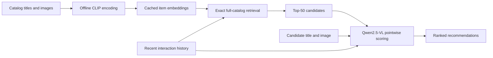

# Multimodal Sequential Recommendation on MicroLens

This project predicts the next item in a user's interaction sequence. It retrieves 50 candidates from the full 19,220-item MicroLens catalog using cached CLIP image and text embeddings, then reranks those candidates with Qwen2.5-VL-3B using the user's recent history. The repository includes offline encoding, exact retrieval, zero-shot and adapter-based reranking, per-user evaluation, and latency benchmarking.

> **Results provenance.** The archived retrieval and zero-shot Qwen results are measurements on the validation split. The end-to-end study uses the supplied hypothetical outcomes, including the fine-tuned scores, test metrics, image ablations, and latency figures. These results are simulated and unmeasured.

[Architecture](#architecture) · [Training](#training) · [Evaluation](#evaluation-protocol) · [Results](#results) · [Running the project](#running-the-project) · [Repository layout](#repository-layout)

## Architecture



### Data and task

Each eligible MicroLens sequence contains at least two interactions. The final interaction is the target, and up to five preceding interactions form the model input. The loader retains the official train, validation, and test splits and the order in each sequence. The TSV files contain no timestamps, so the experiment assumes the released order follows chronology. Item IDs join the interaction history to catalog titles, images, embeddings, and candidate records. The target is used for training labels and evaluation. A scoring prompt receives the history and one candidate's metadata.

### Stage 1 — CLIP retrieval

CLIP ViT-B/32 encodes catalog titles and images offline into separate 512-dimensional vectors. The cache stores both arrays, sorted item IDs, and an image availability mask. Each item's retrieval representation is the normalized average of its normalized title and image vectors.

For candidate `c`, let `s_j(c)` be its cosine similarity to history item `j`. The score combines the strongest match anywhere in the recent history and the match to the latest item.

```text
score(c) = 0.75 × max_j s_j(c) + 0.25 × s_last(c)
```

The maximum lets different candidates match different interests. The latest interaction gives the ranking a recency bias. The system scores the entire catalog, excludes the input history, and breaks score ties by ascending item ID. The main configuration returns 50 items. The same scoring rule at K=100 gives a candidate list whose first 50 items match the Top-50 list.

### Stage 2 — Qwen reranking

The default `onerec@v1` prompt uses history titles and one candidate's title and image. History images are disabled by default. The candidate image uses a pixel budget of 50,176 to 200,704. Qwen scores each candidate independently at the first answer position using `logP(Yes) − logP(No)`. The two answers share the same softmax denominator, so the Hugging Face scorer obtains the margin directly with an FP32 projection of the final hidden state. That reduces score ties from BF16 rounding. The final recommendation list sorts candidates by this margin.

The CLIP order is the retrieval-only baseline. A hybrid variant blends CLIP and Qwen rank percentiles. To isolate the image signal at inference, the image ablation removes the candidate image from the Qwen prompt while holding the retrieved candidate list, titles, history, and adapter fixed. See the [prompt templates](docs/prompts.md) and [scorer implementation](src/mmrr/models/qwen_scorer.py).

## Training

**Labels and negatives.** Each training user's actual next interaction supplies one positive. The dataset adds four negatives per user. Random negatives are sampled from the eligible catalog. Retrieval negatives are sampled from the first 50 CLIP results, where items are more likely to resemble the observed history. Both strategies exclude every item observed in that user's training sequence and use the same eligible users. Unobserved items are treated as negatives for training, so they can include items the user would have liked. The example study assumes 8,192 retained training sequences, zero drops for insufficient negatives, and 40,960 pointwise examples per sampling strategy.

1. **Supervised fine-tuning (SFT).** Teach Qwen to answer `Yes` for the target and `No` for sampled negatives using next-token cross-entropy at the answer position.
2. **Direct preference optimization (DPO).** Merge the SFT adapter into the base model and use that frozen model as the reference. Chosen and rejected are the single-token `Yes` and `No` responses to the **same candidate prompt**. The chosen answer is `Yes` for the observed target and `No` for a sampled negative. For each seed, the random- and retrieval-negative DPO runs use the same random-negative SFT parent.
3. **HaNoRec adaptation.** Add neighbor-based hardness weighting (HaRS) and noise on the LoRA policy path (NoDO) to the pointwise preference objective. The original HaNoRec AUC and small-candidate-pool protocol require a separate reproduction.

LoRA updates the language model's attention and MLP projections. The visual encoder stays frozen. The example uses rank 8, alpha 32, dropout 0.05, a learning rate of 1e-4, one epoch per stage, DPO beta 0.1, and seeds 2025, 2026, and 2027. The base model is `Qwen/Qwen2.5-VL-3B-Instruct` at revision `66285546d2b821cf421d4f5eb2576359d3770cd3`. See the [training implementation](src/mmrr/train.py) and [full experiment matrix](configs/final_experiments.json).

## Evaluation protocol

- **Retrieval.** Recall@K is the fraction of users whose target appears in the first K retrieved candidates. Catalog coverage is the share of catalog items that appear in any candidate list. For the frequency analysis, group users by how often their target occurs in the training split.
- **End-to-end ranking.** HR@k is the fraction of users whose target ranks in the first k positions. With one target per user, NDCG@k weights each hit at rank `r` by `1 / log2(r + 1)`. A retrieval miss contributes zero to both metrics.
- **Conditional ranking.** Evaluate the same metrics only for users whose target entered the candidate pool. Multiplying a conditional metric by Recall@K gives the corresponding end-to-end metric before rounding. This exposes the contribution of ranking within the pool separately from candidate coverage.
- **Model selection.** Select the fusion weight and main configuration on validation NDCG@10, then freeze the configuration before testing. Use the same users and natural candidate lists for pairwise comparisons. The `compare` command computes a paired user-level bootstrap from saved ranks.
- **Efficiency.** Use `benchmark` on the same query sample and hardware after warmup, and time every candidate in each query. During quality evaluation, `--hits-only` can skip retrieval misses without changing HR or NDCG.

## Results

### Archived validation measurements

The selected 75/25 history aggregation retrieved 357 of 5,000 targets at K=50 and 499 of 5,000 at K=100. The previous history-weighted CLIP baseline retrieved 324 at K=50. The selected rule therefore raised validation Recall@50 from 6.48% to 7.14%, an absolute increase of 0.66 percentage points. See the [retrieval report](reports/retrieval/history-interest-report.md) and [frozen candidate metadata](manifests/microlens/val_interest_max_last_025_a0p5_top100.meta.json).

| Natural Top-100 validation ranking | HR@3 | NDCG@3 | HR@10 | NDCG@10 |
|---|---:|---:|---:|---:|
| CLIP retrieval order | 1.28% | 1.01% | 3.02% | 1.61% |
| Zero-shot Qwen | 0.82% | 0.63% | 2.44% | 1.20% |

The archive scored all 499 retrieval hits and reports the end-to-end averages over 5,000 users. Zero-shot reranking lowered HR@10 by 0.58 points in this validation run, motivating comparisons with fusion and adapter training. See the [zero-shot validation report](reports/rerank/interest100-rerank-report.md) and [archived scores](reports/rerank/interest100_hits/val.jsonl).

### End-to-end study (simulated)

The scenario assumes 5,000 eligible users in each split. Methods at a given K share the same natural candidate manifest. The Top-50 ranking table scales HR and NDCG by 100. Rows for fine-tuned methods average three hypothetical seeds.

| Split and budget | Users | Recall@10 | Recall@20 | Recall@50 | Recall@100 | Catalog coverage |
|---|---:|---:|---:|---:|---:|---:|
| Val / interest50 | 5,000 | 3.00% | 4.60% | 7.20% | — | 81.53% (15,670) |
| Val / interest100 | 5,000 | 3.00% | 4.60% | 7.20% | 10.00% | 88.61% (17,030) |
| Test / interest50 | 5,000 | 2.86% | 4.42% | 6.88% | — | 80.62% (15,495) |
| Test / interest100 | 5,000 | 2.86% | 4.42% | 6.88% | 9.56% | 88.15% (16,942) |

| Method | Val HR@3 | Val NDCG@3 | Val HR@10 | Val NDCG@10 | Test HR@3 | Test NDCG@3 | Test HR@10 | Test NDCG@10 |
|---|---:|---:|---:|---:|---:|---:|---:|---:|
| CLIP retrieval order | 1.28 | 0.96 | 3.00 | 1.57 | 1.20 | 0.90 | 2.86 | 1.48 |
| Zero-shot Qwen | 0.92 | 0.68 | 2.44 | 1.21 | 0.86 | 0.64 | 2.32 | 1.15 |
| CLIP/Qwen rank fusion | 1.38 | 1.04 | 3.18 | 1.68 | 1.28 | 0.97 | 3.02 | 1.58 |
| SFT, random negatives | 1.44 | 1.09 | 3.26 | 1.73 | 1.32 | 1.00 | 3.10 | 1.63 |
| SFT, retrieval negatives | 1.54 | 1.17 | 3.40 | 1.83 | 1.42 | 1.07 | 3.24 | 1.72 |
| DPO, random negatives | 1.60 | 1.22 | 3.52 | 1.90 | 1.48 | 1.13 | 3.34 | 1.78 |
| DPO, retrieval negatives | 1.78 | 1.37 | 3.78 | 2.07 | 1.66 | 1.27 | 3.58 | 1.95 |
| HaNoRec, random negatives | 1.64 | 1.25 | 3.54 | 1.92 | 1.50 | 1.15 | 3.34 | 1.80 |
| HaNoRec, retrieval negatives | 1.82 | 1.40 | 3.84 | 2.11 | 1.64 | 1.26 | 3.62 | 1.95 |

In this scenario, DPO with retrieval negatives moves 179 of the 344 test retrieval hits into the top ten. That gives **52.03% conditional HR@10** and **3.58% end-to-end HR@10**. The latter is 0.72 percentage points above CLIP and 0.24 points above DPO with random negatives. The fusion variant uses a Qwen weight of 0.25 and is 0.16 points above CLIP on test HR@10. HaNoRec with retrieval negatives is 0.04 points above the equivalent DPO variant, with both test NDCG@10 values rounding to 1.95%.

### Image ablation, negative difficulty, and candidate budgets (simulated)

The image comparisons hold the candidate pool and adapter fixed. The difficulty comparisons use the same training users and sample negatives from different bands of the original CLIP ranking.

| K | Variant | Candidate recall | HR@3 | NDCG@3 | HR@10 | NDCG@10 |
|---:|---|---:|---:|---:|---:|---:|
| 50 | Zero-shot Qwen, candidate images included | 6.88% | 0.86% | 0.64% | 2.32% | 1.15% |
| 50 | Zero-shot Qwen, candidate images masked | 6.88% | 0.80% | 0.58% | 2.18% | 1.06% |
| 50 | DPO, retrieval negatives, candidate images included | 6.88% | 1.66% | 1.27% | 3.58% | 1.95% |
| 50 | DPO, retrieval negatives, candidate images masked | 6.88% | 1.52% | 1.16% | 3.36% | 1.81% |
| 50 | DPO, retrieval negatives, history images added | 6.88% | 1.68% | 1.29% | 3.60% | 1.97% |
| 50 | DPO, retrieval negatives, `minionerec` prompt | 6.88% | 1.54% | 1.17% | 3.42% | 1.83% |
| 50 | DPO, negatives from CLIP ranks 1–10 | 6.88% | 1.62% | 1.24% | 3.54% | 1.92% |
| 50 | DPO, negatives from CLIP ranks 41–50 | 6.88% | 1.52% | 1.16% | 3.34% | 1.80% |
| 100 | CLIP retrieval order | 9.56% | 1.20% | 0.90% | 2.86% | 1.48% |
| 100 | Zero-shot Qwen, candidate images included | 9.56% | 0.86% | 0.63% | 2.30% | 1.13% |
| 100 | DPO, retrieval negatives, candidate images included | 9.56% | 1.70% | 1.31% | 3.72% | 2.02% |

Masking the candidate image reduces the retrieval-negative DPO group's test HR@10 from 3.58% to 3.36% and NDCG@10 from 1.95% to 1.81%. Candidate recall stays at 6.88%, so the difference occurs within the reranker. The simulated interval for the HR@10 change from including images is [−0.13, +0.57] percentage points and spans zero. Among the two difficulty bands, ranks 1–10 are 0.20 points ahead of ranks 41–50 on HR@10.

### Latency and memory (simulated)

This scenario assumes serial requests on one RTX 4090 with Linux, BF16, PyTorch 2.5.1 with CUDA 12.4, and a candidate batch size of one. Both budgets reuse a cache estimated at 75.24 MiB from two float32 feature arrays, int64 item IDs, and a Boolean image mask.

| Candidate budget | Offline encoding | Cache size | Retrieval P50 / P95 | Reranking P50 / P95 | Queries per second | Peak allocated GPU memory |
|---|---:|---:|---:|---:|---:|---:|
| Top-50 | 5.8 min | 75.24 MiB | 7.8 / 13.6 ms | 4.42 / 5.58 s | 0.217 | 10.4 GiB |
| Top-100 | 5.8 min | 75.24 MiB | 8.1 / 14.1 ms | 8.62 / 10.96 s | 0.112 | 10.5 GiB |

P50 is the median query latency. P95 is the latency at or below which 95% of queries finish. Compared with K=50, K=100 adds 134 test retrieval hits and 0.14 points to the DPO test HR@10 in the scenario. Reranking P95 rises from 5.58 to 10.96 seconds, making the extra candidate scoring the main latency cost in the comparison.

<details>
<summary>Additional simulated results and calculation details</summary>

#### Recall by target frequency

Each entry reports retrieval hits over users in that frequency bucket. Targets with zero training interactions have the lowest recall at both budgets in the scenario.

| Target frequency in train | Val Top-50 | Val Top-100 | Test Top-50 | Test Top-100 |
|---|---:|---:|---:|---:|
| 0 | 24 / 600 (4.00%) | 36 / 600 (6.00%) | 22 / 620 (3.55%) | 35 / 620 (5.65%) |
| 1–10 | 95 / 1,500 (6.33%) | 137 / 1,500 (9.13%) | 90 / 1,490 (6.04%) | 126 / 1,490 (8.46%) |
| 11–100 | 161 / 2,050 (7.85%) | 215 / 2,050 (10.49%) | 155 / 2,050 (7.56%) | 210 / 2,050 (10.24%) |
| 101+ | 80 / 850 (9.41%) | 112 / 850 (13.18%) | 77 / 840 (9.17%) | 107 / 840 (12.74%) |
| Total | 360 / 5,000 (7.20%) | 500 / 5,000 (10.00%) | 344 / 5,000 (6.88%) | 478 / 5,000 (9.56%) |

#### Ranking on retrieval hits

The Top-50 conditional denominators are 360 validation users and 344 test users. Values are scaled by 100.

| Method | Val HR@3 | Val NDCG@3 | Val HR@10 | Val NDCG@10 | Test HR@3 | Test NDCG@3 | Test HR@10 | Test NDCG@10 |
|---|---:|---:|---:|---:|---:|---:|---:|---:|
| CLIP retrieval order | 17.78 | 13.37 | 41.67 | 21.75 | 17.44 | 13.08 | 41.57 | 21.55 |
| Zero-shot Qwen | 12.78 | 9.43 | 33.89 | 16.82 | 12.50 | 9.25 | 33.72 | 16.67 |
| CLIP/Qwen rank fusion | 19.17 | 14.51 | 44.17 | 23.30 | 18.60 | 14.10 | 43.90 | 22.99 |
| SFT, random negatives | 20.00 | 15.11 | 45.28 | 23.99 | 19.19 | 14.57 | 45.06 | 23.67 |
| SFT, retrieval negatives | 21.39 | 16.25 | 47.22 | 25.37 | 20.64 | 15.62 | 47.09 | 24.93 |
| DPO, random negatives | 22.22 | 16.98 | 48.89 | 26.37 | 21.51 | 16.39 | 48.55 | 25.91 |
| DPO, retrieval negatives | 24.72 | 19.00 | 52.50 | 28.79 | 24.13 | 18.50 | 52.03 | 28.33 |
| HaNoRec, random negatives | 22.78 | 17.40 | 49.17 | 26.70 | 21.80 | 16.68 | 48.55 | 26.11 |
| HaNoRec, retrieval negatives | 25.28 | 19.45 | 53.33 | 29.34 | 23.84 | 18.25 | 52.62 | 28.38 |

For the retrieval-negative DPO test group, the rank-one through rank-ten counts are 38, 24, 21, 17, 16, 15, 14, 13, 11, and 10. The remaining 165 retrieved targets are at ranks 11–50, and 4,656 targets fall outside the pool. These counts give 179 / 5,000 end-to-end HR@10 and 179 / 344 conditional HR@10.

#### Between-seed variation and paired differences

The three hypothetical seeds shift small numbers of hits between ranks one or four and ranks 11–50 while preserving candidate recall. The table reports sample standard deviations in percentage points.

| Method | Val HR@3 SD | Val NDCG@3 SD | Val HR@10 SD | Val NDCG@10 SD | Test HR@3 SD | Test NDCG@3 SD | Test HR@10 SD | Test NDCG@10 SD |
|---|---:|---:|---:|---:|---:|---:|---:|---:|
| SFT, random negatives | 0.08 | 0.08 | 0.14 | 0.11 | 0.06 | 0.06 | 0.14 | 0.09 |
| SFT, retrieval negatives | 0.06 | 0.06 | 0.14 | 0.09 | 0.08 | 0.08 | 0.14 | 0.11 |
| DPO, random negatives | 0.10 | 0.10 | 0.16 | 0.13 | 0.08 | 0.08 | 0.18 | 0.12 |
| DPO, retrieval negatives | 0.06 | 0.06 | 0.14 | 0.09 | 0.06 | 0.06 | 0.14 | 0.09 |
| HaNoRec, random negatives | 0.08 | 0.08 | 0.18 | 0.12 | 0.10 | 0.10 | 0.18 | 0.13 |
| HaNoRec, retrieval negatives | 0.08 | 0.08 | 0.16 | 0.11 | 0.10 | 0.10 | 0.16 | 0.13 |

The paired changes are variant minus baseline. The simulated 95% intervals use a normal approximation to the HR@10 gains and losses in the table. Use the paired bootstrap with per-user ranks for an actual run.

| Test comparison | ΔHR@3 | ΔNDCG@3 | ΔHR@10 | ΔNDCG@10 | HR@10 gains / losses | Simulated HR@10 interval |
|---|---:|---:|---:|---:|---:|---:|
| Zero-shot Qwen − CLIP | −0.34 | −0.26 | −0.54 | −0.34 | 27 / 54 | [−0.89, −0.19] |
| SFT, retrieval vs. random negatives | +0.10 | +0.07 | +0.14 | +0.09 | 37 / 30 | [−0.18, +0.46] |
| DPO, retrieval negatives − CLIP | +0.46 | +0.37 | +0.72 | +0.47 | 68 / 32 | [+0.33, +1.11] |
| DPO, retrieval vs. random negatives | +0.18 | +0.15 | +0.24 | +0.17 | 49 / 37 | [−0.12, +0.60] |
| HaNoRec vs. DPO, both with retrieval negatives | −0.02 | −0.02 | +0.04 | +0.00 | 33 / 31 | [−0.27, +0.35] |
| DPO, candidate images included vs. masked | +0.14 | +0.11 | +0.22 | +0.14 | 45 / 34 | [−0.13, +0.57] |

#### Target injection diagnostic

The injected scenario starts with 500 users whose targets were missed by natural Top-100 retrieval. It replaces the last candidate with the target and inserts that target at a random position. This diagnostic tests ranking when the list contains a target alongside high-scoring retrieval alternatives. Its denominator is the 500 injected users.

| Injected candidate ranking | HR@3 | NDCG@3 | HR@10 | NDCG@10 |
|---|---:|---:|---:|---:|
| Random insertion order | 2.80% | 2.03% | 9.80% | 4.46% |
| Zero-shot Qwen | 3.20% | 2.26% | 9.60% | 4.49% |
| DPO, retrieval negatives | 4.20% | 3.08% | 10.80% | 5.40% |

</details>

## Running the project

Run the examples from the repository root. The archive check works on CPU. The full training and scoring workflow uses Linux and one NVIDIA GPU. The catalog assets, model weights, and generated adapters live outside Git.

### 1. Recompute the archived validation result on CPU

Activate a Python environment and choose a fresh output directory for the archive check. The candidate and score files are already tracked in the repository.

```bash
python -m pip install -e . numpy pillow

python scripts/pipeline.py evaluate \
  --manifest manifests/microlens/val_interest_max_last_025_a0p5_top100.jsonl \
  --scores reports/rerank/interest100_hits/val.jsonl \
  --catalog-size 19220 \
  --output outputs/archive_check
```

The expected result has 5,000 users and 499 retrieval hits. End-to-end HR@10 is 0.0302 for CLIP and approximately 0.0244 for Qwen. The command writes summary ratios to `metrics.json` and one rank record per user to `ranks.jsonl`.

### 2. Prepare the GPU environment and catalog cache

Set `MMRR_DATA_ROOT` to the parent of the extracted `microlens/` directory. That directory should contain `train.tsv`, `val.tsv`, `test.tsv`, `Microlens_titles.csv`, and `images/`.

```bash
export MMRR_DATA_ROOT=/path/to/extracted/data
export MMRR_OUTPUT_ROOT=/path/to/outputs
export HF_HOME=/path/to/hf-cache
export CUDA_VISIBLE_DEVICES=0
export QWEN_MODEL=Qwen/Qwen2.5-VL-3B-Instruct

python3.11 -m venv .venv
source .venv/bin/activate
python -m pip install torch==2.5.1 torchvision==0.20.1 \
  --index-url https://download.pytorch.org/whl/cu124
python -m pip install -r requirements-final.txt
python -m pip install -e .
python scripts/pipeline.py preflight --gpu

python scripts/encode_items.py --dataset microlens --metadata-only --img-bs 32
```

Reuse an existing compatible cache by placing its four `.npy` arrays and `meta.json` in `$MMRR_OUTPUT_ROOT/emb/clip-vit-b32/microlens/` and skipping the encoder command. To use a local Qwen snapshot, set `QWEN_MODEL` to its directory before starting a run. The [single-GPU runbook](docs/final_pipeline.md) covers the two-step smoke test and precision settings.

For a quick catalog demo after caching, use item IDs from a known sequence. Remove `--clip-only` to score the same 50 candidates with Qwen.

```bash
python scripts/pipeline.py recommend \
  --history 3176 16351 17865 17698 \
  --k 50 --show 10 --clip-only
```

### 3. Train and validate a Top-50 adapter

This one-seed example trains the random-negative SFT parent and the retrieval-negative DPO adapter. The user cap follows the example design. The `prepare` command records how many users and examples it actually retains.

```bash
R="$MMRR_OUTPUT_ROOT/top50_run"
PARENT="$R/sft_random/adapter"
DPO="$R/dpo_retrieved/adapter"
V=manifests/microlens/val_interest_max_last_025_a0p5_top50.jsonl

python scripts/pipeline.py candidates \
  --split train --k 50 --max-users 8192 --output "$R/train.jsonl"
python scripts/pipeline.py prepare \
  --manifest "$R/train.jsonl" --seed 2025 --output "$R/examples"

python scripts/pipeline.py train \
  --stage sft --examples "$R/examples/random.jsonl" \
  --model "$QWEN_MODEL" --seed 2025 --batch-size 1 --accumulation 16 \
  --output "$R/sft_random"
python scripts/pipeline.py train \
  --stage dpo --examples "$R/examples/retrieved.jsonl" \
  --model "$QWEN_MODEL" --sft-adapter "$PARENT" \
  --seed 2025 --batch-size 1 --accumulation 16 --output "$R/dpo_retrieved"

python scripts/pipeline.py score \
  --manifest "$V" --model "$QWEN_MODEL" --hits-only \
  --sft-adapter "$PARENT" --adapter "$DPO" --output "$R/val_dpo"
python scripts/pipeline.py evaluate \
  --manifest "$V" --scores "$R/val_dpo/scores.jsonl" \
  --catalog-size 19220 --output "$R/eval_val_dpo"
```

For the full matrix, reuse the same validation manifest, select the fusion weight on validation, and use a shared SFT parent for each matched preference comparison. The [runbook](docs/final_pipeline.md) includes the random-negative, fusion, multiple-seed, and HaNoRec variants.

### 4. Evaluate the frozen setup and benchmark both budgets

After selecting the configuration on validation, generate a natural test manifest once. The paired scoring commands use the same manifest, model, and adapter.

```bash
T="$R/test.jsonl"
python scripts/pipeline.py candidates --split test --k 50 --output "$T"
python scripts/pipeline.py evaluate \
  --manifest "$T" --popularity --output "$R/eval_test_clip"

python scripts/pipeline.py score \
  --manifest "$T" --model "$QWEN_MODEL" --hits-only \
  --sft-adapter "$PARENT" --adapter "$DPO" --output "$R/test_dpo"
python scripts/pipeline.py score \
  --manifest "$T" --model "$QWEN_MODEL" --hits-only --no-candidate-images \
  --sft-adapter "$PARENT" --adapter "$DPO" --output "$R/test_dpo_masked"

for variant in test_dpo test_dpo_masked; do
  python scripts/pipeline.py evaluate \
    --manifest "$T" --scores "$R/$variant/scores.jsonl" --output "$R/eval_$variant"
done

python scripts/pipeline.py compare \
  --baseline "$R/eval_test_dpo_masked/ranks.jsonl" \
  --variant "$R/eval_test_dpo/ranks.jsonl" --output "$R/image_ablation.json"

for k in 50 100; do
  python scripts/pipeline.py benchmark --split test --k "$k" \
    --model "$QWEN_MODEL" --sft-adapter "$PARENT" --adapter "$DPO" \
    --output "$R/timing_k$k.json"
done
```

Resume interrupted training with `train --resume` and the original configuration. Repeating the scoring command with the same configuration and output directory reuses verified shards. Use new output paths for changed inputs or settings. Track the input and candidate manifest hashes, model revision, adapter metadata, scoring configuration, per-user ranks, and latency logs for each measured run. See the [formal results template](reports/final_results_template.md).

## Repository layout

| Path | Contents |
|---|---|
| [`scripts/pipeline.py`](scripts/pipeline.py) | Main CLI for candidate generation, training, scoring, evaluation, and benchmarking |
| [`src/mmrr/`](src/mmrr/) | Data loading, retrieval, prompt assembly, model scoring, preference training, and ranking metrics |
| [`manifests/microlens/`](manifests/microlens/) | Frozen validation candidate lists and their metadata |
| [`configs/`](configs/) | Experiment matrix and archived zero-shot scoring settings |
| [`reports/retrieval/`](reports/retrieval/) and [`reports/rerank/`](reports/rerank/) | Archived validation reports and per-user scoring records |
| [`docs/`](docs/) | Data contracts, prompts, setup, and single-GPU run instructions |
| [`tests/`](tests/) | Regression tests for retrieval, data loading, model-facing interfaces, and evaluation |
